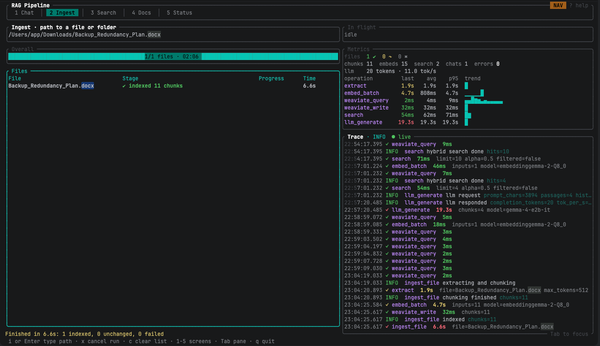
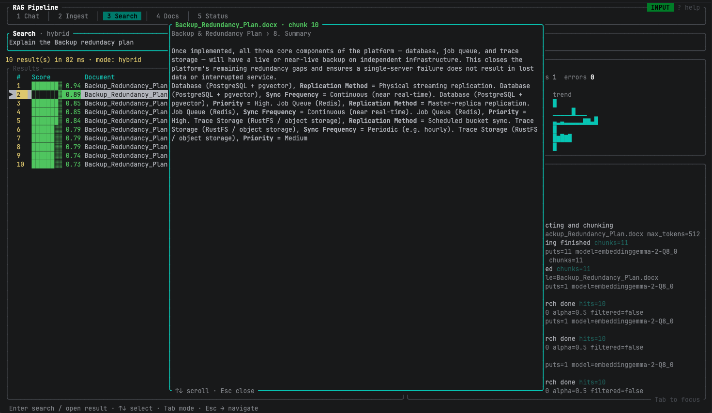
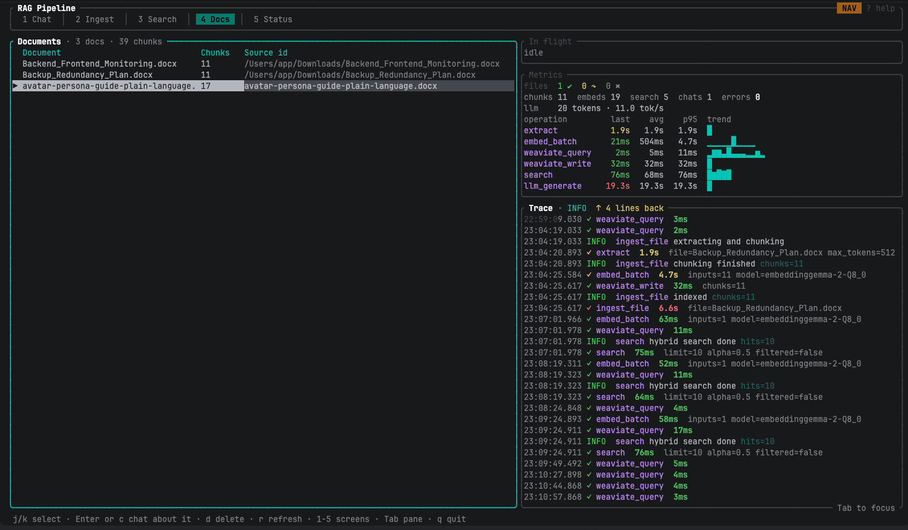
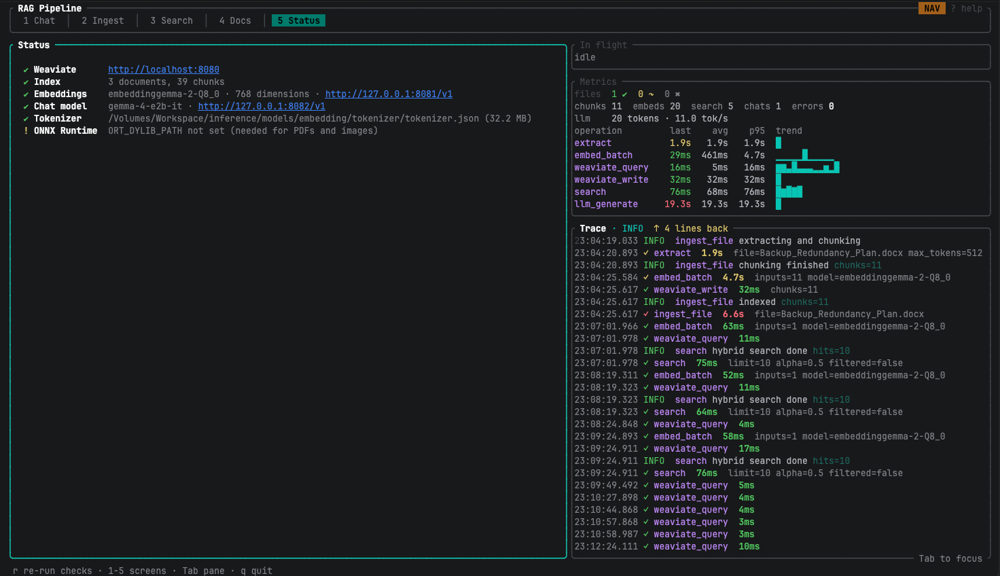
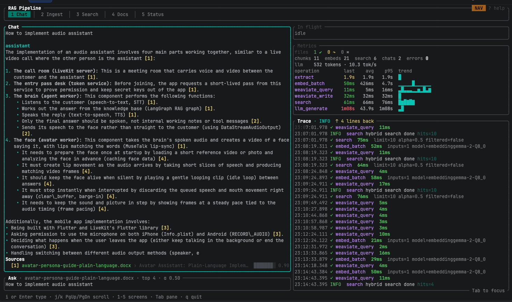
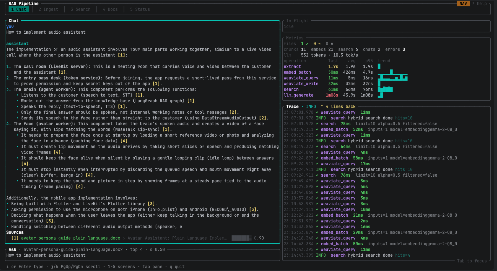
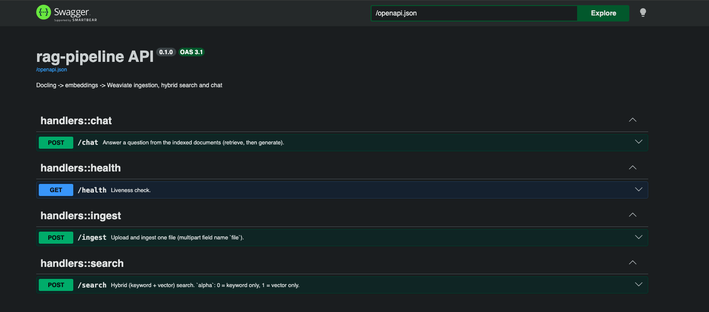
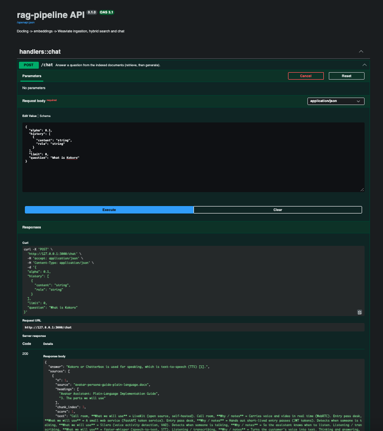

# Performant RAG Pipeline

Rust ingestion, hybrid retrieval and chat over your documents:  
**docling.rs** (extract + token-aware chunking) → **EmbeddingGemma 2** (OpenAI-compatible endpoint) → **Weaviate** (bring-your-own vectors) → answers from a local chat model (llama-server).

```
file → sha256 → unchanged? skip
→ docling.rs convert → HybridChunker (tokenizer.json of the embedding model)
→ embed (heading path + chunk) → replace the document's chunks → Weaviate
question → embed → Weaviate hybrid search (BM25 + vector, alpha) → top chunks → chat model → answer + sources
```

## Project layout

```
src/
main.rs               bootstrap: env, logging mode, services, dispatch
config.rs             environment configuration
context.rs            AppContext: wires the services once, cheap to clone
util.rs               path / text helpers
models/               plain data types (chat, document, health, search)
services/             business logic and clients
extractor.rs          docling.rs extraction + chunking (the only docling touchpoint)
embedder.rs           embeddings client
vector_store.rs       Weaviate over REST + GraphQL
llm.rs                chat-model client and prompt building
pipeline.rs           ingestion orchestration
rag.rs                retrieve + answer (shared by API, TUI and CLI)
health.rs             readiness checks
api/                  HTTP layer
mod.rs                router + OpenAPI / Swagger UI
state.rs  error.rs  dto.rs
handlers/             one file per endpoint: health, ingest, search, chat
cli/                  command-line entry points
mod.rs                clap definitions + dispatch
commands.rs           ingest, search, serve
plain_chat.rs         script-friendly chat
classic.rs            single-pane prompt-and-menu UI
observability/        tracing layer, event types, metrics registry
tui/                  split-pane terminal UI
app.rs  ui.rs  input.rs  markdown.rs  theme.rs  widgets.rs
screens/              chat, ingest, search, docs, status
obs/                  in-flight operations, metrics, live trace log
```

## Setup

1. Rust **1.92+** (docling 1.103 requires it).
2. `docker compose up -d` (Weaviate on :8080). Bump `WEAVIATE_VERSION` to a current release.
3. Serve the embedding model and a chat model with llama-server (or any OpenAI-compatible server) and set  
   `EMBED_*` / `CHAT_*` in `.env`.
4. Download `tokenizer.json` from the **google/embeddinggemma-2** repo and set `CHUNK_TOKENIZER` to its absolute path.
5. `cp .env.example .env`. Values containing spaces or `|` (the task prefixes) **must be quoted**.
6. For PDFs and images export `ORT_DYLIB_PATH=/path/to/libonnxruntime.dylib` (docling uses `ort-load-dynamic`).

## Run

```bash
cargo run --release                  # split-pane UI with live tracing (the default)
cargo run --release -- classic       # single-pane prompt-and-menu UI
cargo run --release -- serve         # HTTP API, Swagger UI at /docs
cargo run --release -- ingest ./docs
cargo run --release -- search "question"
cargo run --release -- chat "question"
```

## The split-pane UI

The active screen (Chat, Ingest, Search, Docs, Status) is on the left; observability is on the right  
(or underneath on narrow terminals) and updates live while a question or an ingestion runs:

- **In flight**: every running operation (`ingest_file`, `extract`, `embed_batch`, `weaviate_write`, `search`, `llm_generate`) with its elapsed time.
- **Metrics**: files indexed / skipped / failed, chunks, embeddings, searches, chats, errors, LLM tokens and tok/s, and last / average / p95 latency per operation with a small trend chart.
- **Trace**: a timestamped, color-coded log of tracing events and span timings.

Keys: `Esc` leaves the text field (NAV mode), `i`/`Enter` types again, `1`-`5` / `h` `l` switch screens, `Tab` focuses the trace pane, `v` verbosity (INFO/DEBUG/TRACE), `p` pause, `X` clear, `L` layout (right / bottom / hidden), `?` help, `q` or `Ctrl-C` quit. Chat has slash-commands (`/help`). Set `RAG_LOG_FILE` to also write the trace to a file.

### Ingest screen



### Search screen



### Docs screen



### Status screen



### Chat screen





## API

`POST /ingest` (multipart `file`), `POST /search`, `POST /chat`, `GET /health`; Swagger UI at `/docs`.





## Notes

- Weaviate is queried over REST + GraphQL (there is no official Rust client).
- Documents ingested from the terminal are identified by their full path; uploads through `/ingest` by filename.
- Ingestion embeds before it deletes a document's old chunks, but delete + insert is not atomic.
- Without the `docling` feature only `.txt`, `.md` and `.csv` can be read.
```